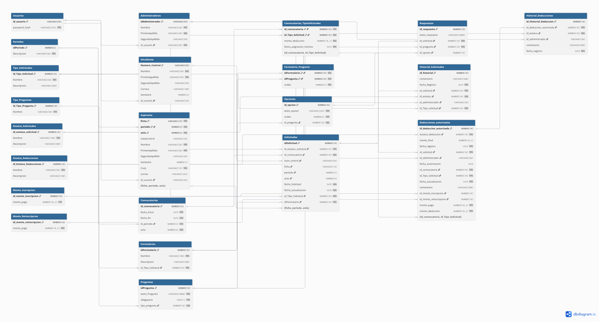

# Base de datos de SAReduccion

## 1. Proposito

La base de datos administra las solicitudes de reduccion del monto de inscripcion y reinscripcion. El modelo utiliza Oracle Database y se construye con el script:

[`docker/init-db/02-init-shema.sql`](docker/init-db/02-init-shema.sql)

El script crea tablas, claves primarias, claves foraneas, restricciones, secuencias, triggers e informacion inicial de catalogos.

## 2. Ubicacion y ejecucion

El script se encuentra en `docker/init-db/`, carpeta que se monta en Oracle desde [docker-compose.yml](docker-compose.yml):

```yaml
- ./docker/init-db:/container-entrypoint-initdb.d:ro
```

Los archivos con extension `.sql` de esa carpeta se ejecutan cuando Oracle inicializa el volumen de datos. Los archivos `.bak` no se ejecutan automaticamente.

Para crear la base de datos desde cero:

```bash
docker compose down -v
docker compose up oracle-db
```

El parametro `-v` elimina el volumen `sareduccion_oracle_data`. Si no se elimina el volumen, Oracle conserva las tablas existentes y no vuelve a ejecutar los scripts iniciales.

## 3. Modelo de datos

En las tablas siguientes:

- **PK** significa clave primaria.
- **FK** significa clave foranea.
- **UK** significa restriccion de unicidad.
- **NULL** significa que el valor es opcional.
- **NOT NULL** significa que el valor es obligatorio.

### 3.1 Catalogos y seguridad

#### Tabla: `Usuarios`

Almacena las credenciales de acceso. Sus registros son utilizados por estudiantes, aspirantes y administradores.

| Atributo | Tipo | Restricciones | Descripcion |
| --- | --- | --- | --- |
| `id_usuario` | `VARCHAR2(50)` | PK, NOT NULL | Identificador unico del usuario. |
| `password_hash` | `VARCHAR2(255)` | NOT NULL | Contrasena almacenada como hash. |

#### Tabla: `Periodos`

Contiene el catalogo de periodos escolares y es utilizada por aspirantes y convocatorias.

| Atributo | Tipo | Restricciones | Descripcion |
| --- | --- | --- | --- |
| `idPeriodo` | `NUMBER(2)` | PK, NOT NULL | Identificador del periodo. |
| `Descripcion` | `VARCHAR2(50)` | NOT NULL, UK | Nombre del periodo, por ejemplo `Agosto-Diciembre`. |

#### Tabla: `Tipo_Solicitudes`

Define los tipos de tramite que puede realizar una persona.

| Atributo | Tipo | Restricciones | Descripcion |
| --- | --- | --- | --- |
| `id_Tipo_Solicitud` | `NUMBER(10)` | PK, NOT NULL | Identificador del tipo de solicitud. |
| `Nombre` | `VARCHAR2(50)` | NOT NULL | Nombre del tipo de tramite. |
| `Descripcion` | `VARCHAR2(200)` | NULL | Explicacion del tipo de tramite. |

#### Tabla: `Tipo_Preguntas`

Define la forma en que se responde una pregunta del formulario.

| Atributo | Tipo | Restricciones | Descripcion |
| --- | --- | --- | --- |
| `id_Tipo_Pregunta` | `NUMBER(10)` | PK, NOT NULL | Identificador del tipo de pregunta. |
| `Nombre` | `VARCHAR2(50)` | NOT NULL, UK | Nombre del tipo: `ABIERTA`, `OPCION_UNICA`, `MIXTA` o `MULTIPLE`. |

#### Tabla: `Estatus_Solicitudes`

Catalogo de estados de una solicitud.

| Atributo | Tipo | Restricciones | Descripcion |
| --- | --- | --- | --- |
| `id_estatus_solicitud` | `NUMBER(10)` | PK, NOT NULL | Identificador del estado. |
| `Nombre` | `VARCHAR2(100)` | NOT NULL, UK | Nombre del estado. |
| `Descripcion` | `VARCHAR2(200)` | NULL | Explicacion del estado. |

Estados iniciales:

| ID | Estado | Descripcion |
| --- | --- | --- |
| 1 | `PENDIENTE` | Solicitud pendiente de revision. |
| 2 | `AUTORIZADO` | Solicitud autorizada. |
| 3 | `RECHAZADO` | Solicitud rechazada. |
| 4 | `CANCELADO` | Solicitud cancelada. |
| 5 | `APLICADO` | Solicitud aplicada o pagada. |

#### Tabla: `Estatus_Deducciones`

Catalogo de estados de las deducciones autorizadas.

| Atributo | Tipo | Restricciones | Descripcion |
| --- | --- | --- | --- |
| `id_Estatus_Deducciones` | `NUMBER(10)` | PK, NOT NULL | Identificador del estado de deduccion. |
| `Nombre` | `VARCHAR2(50)` | NOT NULL | Nombre del estado. |
| `Descripcion` | `VARCHAR2(100)` | NULL | Explicacion del estado. |

### 3.2 Personas y perfiles

#### Tabla: `Estudiante`

Almacena la informacion de los estudiantes que realizan solicitudes de reinscripcion.

| Atributo | Tipo | Restricciones | Descripcion |
| --- | --- | --- | --- |
| `Numero_Control` | `VARCHAR2(50)` | PK, NOT NULL | Numero de control del estudiante. |
| `Nombre` | `VARCHAR2(50)` | NOT NULL | Nombre del estudiante. |
| `PrimerAppellido` | `VARCHAR2(50)` | NOT NULL | Primer apellido. |
| `SegundoApellido` | `VARCHAR2(50)` | NULL | Segundo apellido. |
| `Carrera` | `VARCHAR2(100)` | NULL | Carrera que cursa el estudiante. |
| `Semestre` | `NUMBER(2)` | NULL, CHECK 1-20 | Semestre actual del estudiante. |
| `id_usuario` | `VARCHAR2(50)` | NULL, UK, FK | Usuario relacionado en `Usuarios`. |

#### Tabla: `Aspirante`

Almacena la informacion de los aspirantes de nuevo ingreso. Su clave primaria esta formada por tres atributos.

| Atributo | Tipo | Restricciones | Descripcion |
| --- | --- | --- | --- |
| `ficha` | `VARCHAR2(18)` | PK compuesta, NOT NULL | Numero de ficha del aspirante. |
| `periodo` | `NUMBER(2)` | PK compuesta, NOT NULL, FK | Periodo relacionado en `Periodos`. |
| `anio` | `NUMBER(4)` | PK compuesta, NOT NULL, CHECK 2000-9999 | Anio de la ficha. |
| `claveControl` | `VARCHAR2(50)` | NULL | Clave de control, si existe. |
| `Nombre` | `VARCHAR2(50)` | NOT NULL | Nombre del aspirante. |
| `PrimerApellido` | `VARCHAR2(50)` | NOT NULL | Primer apellido. |
| `SegundoApellido` | `VARCHAR2(50)` | NULL | Segundo apellido. |
| `Semestre` | `NUMBER(2)` | NULL, CHECK 1-20 | Semestre asociado al aspirante. |
| `Curp` | `VARCHAR2(18)` | NOT NULL, CHECK longitud 18 | CURP del aspirante. |
| `correo` | `VARCHAR2(254)` | NULL | Correo electronico. |
| `id_usuario` | `VARCHAR2(50)` | NULL, UK, FK | Usuario relacionado en `Usuarios`. |

#### Tabla: `Administradores`

Almacena los datos del personal que administra y revisa las solicitudes.

| Atributo | Tipo | Restricciones | Descripcion |
| --- | --- | --- | --- |
| `idAdministrador` | `VARCHAR2(50)` | PK, NOT NULL | Identificador del administrador. |
| `Nombre` | `VARCHAR2(50)` | NOT NULL | Nombre del administrador. |
| `PrimerApellido` | `VARCHAR2(50)` | NOT NULL | Primer apellido. |
| `SegundoApellido` | `VARCHAR2(50)` | NULL | Segundo apellido. |
| `id_usuario` | `VARCHAR2(50)` | NOT NULL, UK, FK | Usuario relacionado en `Usuarios`. |

### 3.3 Convocatorias y montos

#### Tabla: `Convocatorias`

Define el periodo de vigencia de una convocatoria.

| Atributo | Tipo | Restricciones | Descripcion |
| --- | --- | --- | --- |
| `id_convocatoria` | `NUMBER(10)` | PK, NOT NULL | Identificador de la convocatoria. |
| `fecha_inicio` | `DATE` | NOT NULL | Fecha en que inicia la convocatoria. |
| `fecha_fin` | `DATE` | NOT NULL, CHECK >= fecha_inicio | Fecha en que termina la convocatoria. |
| `id_periodo` | `NUMBER(2)` | NOT NULL, FK | Periodo escolar relacionado. |
| `anio` | `NUMBER(4)` | NOT NULL, CHECK 2000-9999 | Anio de la convocatoria. |

#### Tabla: `Convocatorias_TipoSolicitudes`

Relaciona una convocatoria con un tipo de solicitud y establece el monto de deduccion. Es una tabla intermedia con clave primaria compuesta.

| Atributo | Tipo | Restricciones | Descripcion |
| --- | --- | --- | --- |
| `id_convocatoria` | `NUMBER(10)` | PK compuesta, NOT NULL, FK | Convocatoria relacionada. |
| `id_Tipo_Solicitud` | `NUMBER(10)` | PK compuesta, NOT NULL, FK | Tipo de solicitud relacionado. |
| `monto_deduccion` | `NUMBER(10,2)` | NOT NULL, CHECK >= 0 | Monto que se puede deducir. |
| `fecha_asignacion_montos` | `DATE` | NOT NULL, DEFAULT `SYSDATE` | Fecha en que se asigno el monto. |

#### Tabla: `Monto_Inscripcion`

Contiene los montos de pago para solicitudes de inscripcion.

| Atributo | Tipo | Restricciones | Descripcion |
| --- | --- | --- | --- |
| `id_monto_inscripcion` | `NUMBER(10)` | PK, NOT NULL | Identificador del monto. |
| `monto_pago` | `NUMBER(10,2)` | NOT NULL, CHECK >= 0 | Monto normal de inscripcion. |

#### Tabla: `Monto_Reinscripcion`

Contiene los montos de pago para solicitudes de reinscripcion.

| Atributo | Tipo | Restricciones | Descripcion |
| --- | --- | --- | --- |
| `id_monto_reinscripcion` | `NUMBER(10)` | PK, NOT NULL | Identificador del monto. |
| `monto_pago` | `NUMBER(10,2)` | NOT NULL, CHECK >= 0 | Monto normal de reinscripcion. |

### 3.4 Formularios y preguntas

#### Tabla: `Formularios`

Representa un formulario asociado a un tipo de solicitud. La restriccion `uk_formulario_tipo_solicitud` permite un solo formulario por tipo de solicitud.

| Atributo | Tipo | Restricciones | Descripcion |
| --- | --- | --- | --- |
| `idFormulario` | `NUMBER(10)` | PK, NOT NULL | Identificador del formulario. |
| `Nombre` | `VARCHAR2(100)` | NOT NULL | Nombre del formulario. |
| `Descripcion` | `VARCHAR2(200)` | NULL | Indicaciones del formulario. |
| `id_Tipo_Solicitud` | `NUMBER(10)` | NOT NULL, UK, FK | Tipo de solicitud al que pertenece. |

#### Tabla: `Preguntas`

Define las preguntas que pueden aparecer en un formulario.

| Atributo | Tipo | Restricciones | Descripcion |
| --- | --- | --- | --- |
| `idPregunta` | `NUMBER(10)` | PK, NOT NULL | Identificador de la pregunta. |
| `texto_Pregunta` | `VARCHAR2(4000)` | NOT NULL | Texto que se muestra al usuario. |
| `obligatoria` | `CHAR(1)` | NOT NULL, DEFAULT `S`, CHECK `S` o `N` | Indica si la pregunta es obligatoria. |
| `tipo_pregunta` | `NUMBER(10)` | NOT NULL, FK | Tipo definido en `Tipo_Preguntas`. |

#### Tabla: `Formulario_Pregunta`

Relaciona preguntas con formularios y define el orden de presentacion.

| Atributo | Tipo | Restricciones | Descripcion |
| --- | --- | --- | --- |
| `idFormulario` | `NUMBER(10)` | PK compuesta, NOT NULL, FK | Formulario relacionado. |
| `idPregunta` | `NUMBER(10)` | PK compuesta, NOT NULL, FK | Pregunta relacionada. |
| `orden` | `NUMBER(5)` | NOT NULL, CHECK > 0, UK por formulario | Posicion de la pregunta dentro del formulario. |

#### Tabla: `Opciones`

Almacena las opciones que pueden seleccionarse en las preguntas.

| Atributo | Tipo | Restricciones | Descripcion |
| --- | --- | --- | --- |
| `id_opcion` | `NUMBER(10)` | PK, NOT NULL | Identificador de la opcion. |
| `texto_opcion` | `VARCHAR2(255)` | NOT NULL | Texto que vera el usuario. |
| `orden` | `NUMBER(5)` | NOT NULL, CHECK > 0, UK por pregunta | Posicion de la opcion. |
| `id_pregunta` | `NUMBER(10)` | NOT NULL, FK | Pregunta a la que pertenece. |

### 3.5 Solicitudes y respuestas

#### Tabla: `Solicitudes`

Registra el tramite realizado por un estudiante o un aspirante. Una solicitud pertenece a un solo perfil.

| Atributo | Tipo | Restricciones | Descripcion |
| --- | --- | --- | --- |
| `idSolicitud` | `NUMBER(10)` | PK, NOT NULL | Folio de la solicitud. |
| `id_estatus_solicitud` | `NUMBER(10)` | NOT NULL, FK | Estado actual de la solicitud. |
| `id_convocatoria` | `NUMBER(10)` | NOT NULL, FK | Convocatoria a la que pertenece. |
| `num_control` | `VARCHAR2(50)` | NULL, FK | Numero de control si la solicitud es de un estudiante. |
| `ficha` | `VARCHAR2(18)` | NULL, FK compuesta | Ficha si la solicitud es de un aspirante. |
| `periodo` | `NUMBER(2)` | NULL, FK compuesta | Periodo de la ficha del aspirante. |
| `anio` | `NUMBER(4)` | NULL, FK compuesta, CHECK 2000-9999 | Anio de la ficha del aspirante. |
| `fecha_Solicitud` | `DATE` | NOT NULL, DEFAULT `SYSDATE` | Fecha de creacion de la solicitud. |
| `fecha_actualizacion` | `DATE` | NOT NULL, DEFAULT `SYSDATE` | Fecha de la ultima actualizacion. |
| `id_Tipo_Solicitud` | `NUMBER(10)` | NOT NULL, FK | Tipo de tramite solicitado. |
| `idFormulario` | `NUMBER(10)` | NOT NULL, FK | Formulario utilizado. |

La restriccion `ck_solicitud_origen` exige una de estas dos opciones:

- Estudiante: `num_control` tiene valor y `ficha`, `periodo` y `anio` son NULL.
- Aspirante: `ficha`, `periodo` y `anio` tienen valor y `num_control` es NULL.

#### Tabla: `Respuestas`

Guarda la respuesta que proporciona el usuario para cada pregunta de una solicitud.

| Atributo | Tipo | Restricciones | Descripcion |
| --- | --- | --- | --- |
| `id_respuesta` | `NUMBER(10)` | PK, NOT NULL | Identificador de la respuesta. |
| `texto_respuesta` | `VARCHAR2(4000)` | NULL | Respuesta escrita por el usuario. |
| `id_solicitud` | `NUMBER(10)` | NOT NULL, FK | Solicitud a la que pertenece. |
| `id_pregunta` | `NUMBER(10)` | NOT NULL, FK | Pregunta que fue respondida. |
| `id_opcion` | `NUMBER(10)` | NULL, FK | Opcion seleccionada, cuando corresponde. |

El indice `ux_respuesta_opcion` evita repetir la misma opcion para una pregunta dentro de una solicitud. El trigger `trg_respuestas_validacion` revisa que el texto u opcion correspondan al tipo de pregunta.

### 3.6 Historial y deducciones

#### Tabla: `Historial_Solicitudes`

Registra los cambios de estado de una solicitud.

| Atributo | Tipo | Restricciones | Descripcion |
| --- | --- | --- | --- |
| `id_historial` | `NUMBER(10)` | PK, NOT NULL | Identificador del movimiento. |
| `comentario` | `VARCHAR2(500)` | NULL | Comentario relacionado con el cambio. |
| `fecha_Registro` | `DATE` | NOT NULL, DEFAULT `SYSDATE` | Fecha del registro. |
| `id_solicitud` | `NUMBER(10)` | NOT NULL, FK | Solicitud cuyo estado cambio. |
| `id_estatus` | `NUMBER(10)` | NOT NULL, FK | Nuevo estado de la solicitud. |
| `id_administrador` | `VARCHAR2(50)` | NULL, FK | Administrador que realizo la accion. |
| `id_Tipo_solicitud` | `NUMBER(10)` | NOT NULL, FK | Tipo de solicitud relacionado. |

#### Tabla: `Deducciones_autorizadas`

Registra la deduccion autorizada para una solicitud y conserva los montos utilizados en ese momento.

| Atributo | Tipo | Restricciones | Descripcion |
| --- | --- | --- | --- |
| `id_deduccion_autorizada` | `NUMBER(10)` | PK, NOT NULL | Identificador de la deduccion. |
| `estatus_deduccion` | `NUMBER(10)` | NOT NULL, FK | Estado de la deduccion. |
| `monto_final` | `NUMBER(10,2)` | NULL, CHECK | Resultado de restar la deduccion al pago. |
| `fecha_registro` | `DATE` | NOT NULL, DEFAULT `SYSDATE` | Fecha de registro. |
| `id_solicitud` | `NUMBER(10)` | NOT NULL, UK, FK | Solicitud beneficiada. Solo puede existir una deduccion por solicitud. |
| `id_administrador` | `VARCHAR2(50)` | NULL, FK | Administrador responsable. |
| `fecha_autorizacion` | `DATE` | NULL | Fecha de autorizacion. |
| `id_convocatoria` | `NUMBER(10)` | NOT NULL, FK compuesta | Convocatoria relacionada. |
| `id_Tipo_Solicitud` | `NUMBER(10)` | NOT NULL, FK compuesta | Tipo de solicitud relacionado. |
| `fecha_actualizacion` | `DATE` | NOT NULL, DEFAULT `SYSDATE` | Fecha de la ultima actualizacion. |
| `comentario` | `VARCHAR2(500)` | NULL | Comentario sobre la deduccion. |
| `id_monto_inscripcion` | `NUMBER(10)` | NULL, FK | Monto utilizado para inscripcion. |
| `id_monto_reinscripcion` | `NUMBER(10)` | NULL, FK | Monto utilizado para reinscripcion. |
| `monto_pago` | `NUMBER(10,2)` | NOT NULL, CHECK >= 0 | Monto original que debe pagar la persona. |
| `monto_deduccion` | `NUMBER(10,2)` | NOT NULL, CHECK >= 0 | Monto que se descuenta. |

La restriccion `ck_da_monto_origen` obliga a usar exactamente un monto: inscripcion o reinscripcion. El trigger `trg_deducciones_calculo` calcula:

```text
monto_final = monto_pago - monto_deduccion
```

#### Tabla: `Historial_Deducciones`

Registra los cambios de estado de una deduccion autorizada.

| Atributo | Tipo | Restricciones | Descripcion |
| --- | --- | --- | --- |
| `id_Historial_Deduccion` | `NUMBER(10)` | PK, NOT NULL | Identificador del registro historico. |
| `id_deduccion_autorizada` | `NUMBER(10)` | NOT NULL, FK | Deduccion cuyo estado cambio. |
| `id_estatus` | `NUMBER(10)` | NOT NULL, FK | Nuevo estado de la deduccion. |
| `id_administrador` | `VARCHAR2(50)` | NULL, FK | Administrador que realizo el cambio. |
| `comentario` | `VARCHAR2(500)` | NULL | Comentario del cambio. |
| `fecha_registro` | `DATE` | NOT NULL, DEFAULT `SYSDATE` | Fecha del registro. |

## 4. Relaciones principales

```text
Usuarios
├── Estudiante
├── Aspirante
└── Administradores

Periodos
├── Aspirante
└── Convocatorias

Tipo_Solicitudes
├── Formularios
└── Convocatorias_TipoSolicitudes

Formularios
└── Formulario_Pregunta ─── Preguntas ─── Opciones

Solicitudes
├── Respuestas
├── Historial_Solicitudes
└── Deducciones_autorizadas ─── Historial_Deducciones
```

## 5. Secuencias y triggers

El script crea secuencias para generar identificadores automaticamente. Los triggers `BEFORE INSERT` asignan el siguiente valor de la secuencia cuando el identificador no se proporciona.

Tambien crea triggers para:

- Validar que el formulario corresponda al tipo de solicitud.
- Validar el formato de las respuestas.
- Confirmar que una opcion pertenezca a la pregunta seleccionada.
- Calcular los montos de una deduccion.
- Registrar cambios de estado en los historiales.
- Propagar una cancelacion de deduccion a la solicitud.
- Actualizar las fechas de modificacion.

## 6. Flujo general

1. Se registra o consulta el usuario y su perfil: estudiante, aspirante o administrador.
2. El administrador configura periodos, convocatorias, tipos de solicitud, montos y formularios.
3. El usuario crea una solicitud asociada a una convocatoria y un formulario.
4. El usuario responde las preguntas y el sistema valida los datos.
5. El administrador revisa la solicitud y actualiza su estatus.
6. Cada cambio de estatus queda registrado en `Historial_Solicitudes`.
7. Cuando corresponde, se crea una deduccion autorizada.
8. El sistema calcula el monto final y registra los cambios en `Historial_Deducciones`.

## 7. Sobre la imagen del diagrama

Una imagen se agrega en Markdown usando esta sintaxis:

```markdown

```

La imagen debe estar en la misma carpeta que el archivo Markdown, o se debe indicar una ruta relativa. La imagen que estaba incluida anteriormente representaba un modelo distinto, por lo que no se mantiene como diagrama del SQL actual.

Cuando se genere el diagrama correcto, se puede guardar junto a este archivo y agregarlo asi:

```markdown

```

## 8. Archivos relacionados

- [Script de creacion de la base de datos](docker/init-db/02-init-shema.sql)
- [Configuracion Docker](docker-compose.yml)
- [Guia del entorno Docker](README-DOCKER.md)
