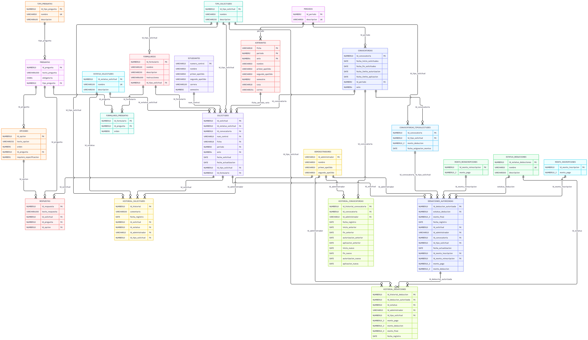

# Base de datos de SAReduccion

## 1. Propósito

La base de datos administra las solicitudes de reducción del monto de inscripción y reinscripción de estudiantes y aspirantes. El modelo utiliza **Oracle XE 21c**, en el esquema `SA_REDUCCION`, y se construye principalmente con [`docker/init-db/02-crear-estructura.sql`](docker/init-db/02-crear-estructura.sql) y [`docker/init-db/05-crear-paquetes-permisos.sql`](docker/init-db/05-crear-paquetes-permisos.sql).

La versión revisada contiene **22 tablas**, con claves primarias, foráneas, restricciones, índices, secuencias y triggers. La identidad de estudiantes, aspirantes y administradores se mantiene en sus tablas correspondientes; no existe una tabla de usuarios intermedia. La lógica de negocio se concentra en cuatro paquetes PL/SQL, uno interno y tres públicos.

## 2. Instalación y ejecución

[`docker/init-db/init-db.sh`](docker/init-db/init-db.sh) coordina la inicialización de Oracle. Los scripts se aplican en orden, con el usuario correspondiente y dentro de `XEPDB1`. La inicialización se realiza cuando se crea el volumen de Oracle por primera vez; modificar un SQL del repositorio **no modifica automáticamente una base ya instalada**.

**Advertencia:** `docker compose down -v` elimina el volumen y los datos de Oracle. No debe utilizarse para actualizar el esquema de trabajo ni para aplicar cambios incrementales. Los cambios posteriores requieren una actualización controlada o una instalación nueva de pruebas.

### 2.1 Scripts de inicialización

| Script | Propósito | Usuario |
| --- | --- | --- |
| `01-configurar-esquema.sql` | Crea el esquema `SA_REDUCCION` y configura el directorio de respaldos. | SYS |
| `02-crear-estructura.sql` | Crea tablas, restricciones, índices, secuencias, triggers y catálogos base, incluidos los dos tipos de solicitud y formularios. | `SA_REDUCCION` |
| `03-crear-identidades-roles.sql` | Crea identidades Oracle y roles de prueba. | SYS |
| `04-crear-cuenta-tecnica.sql` | Crea la cuenta `SAR_BACKEND`. | SYS |
| `05-crear-paquetes-permisos.sql` | Crea los cuatro paquetes PL/SQL y concede a la cuenta técnica ejecución sobre los tres paquetes públicos. | `SA_REDUCCION` |
| `06-seed-desarrollo.sql` | Carga datos ficticios y escenarios de solicitudes, respuestas, historiales y deducciones. | `SA_REDUCCION` |
| `init-db.sh` | Orquesta la instalación y comprueba su resultado. | Automático |

El seed es **de una sola ejecución por esquema nuevo**. Los catálogos esenciales, los tipos de solicitud y los formularios ya existen desde el script `02`; no deben duplicarse en el `06`. En los datos ficticios, las convocatorias usan identificadores explícitos `900001` y `900002`, mientras que el resto de entidades toma sus identificadores de las secuencias creadas en `02`.

### 2.2 Verificaciones

`init-db.sh` comprueba al final de la instalación que existan las 22 tablas, los 16 secuencias, los triggers y los cuatro paquetes con estatus `VALID`, sin objetos inválidos. También verifica los privilegios efectivos de `SAR_BACKEND` y de las cuentas individuales, y que la presencia de datos de aplicación corresponda a `SAR_LOAD_DEV_SEED`.

Las reglas de negocio se validan ejecutando los paquetes sobre una base nueva: creación y unicidad de solicitudes, retirada y reenvío, autorización, rechazo, cancelación, reautorización, aplicación, fechas de convocatoria, historiales y conservación de montos. Actualmente no existe una suite automatizada de estas reglas fuera de `init-db.sh`.

## 3. Modelo de datos

**PK**: clave primaria; **FK**: clave foránea; **UK**: unicidad; **NULL**: opcional; **NOT NULL**: obligatorio; **CHECK**: validación de valores. Los nombres y tipos siguientes corresponden al script vigente `docker/init-db/02-crear-estructura.sql`.

### 3.0 Diagrama entidad-relación



**Nota:** el diagrama debe regenerarse si todavía representa la estructura anterior, especialmente por `Historial_Convocatorias`, las cuatro fechas y el estado `RETIRADO`.

### 3.1 Catálogos y estados

#### Tabla: `Periodos`

Catálogo de periodos académicos.

| Atributo | Tipo | Indicaciones |
| --- | --- | --- |
| `id_periodo` | `NUMBER(2)` | PK |
| `descripcion` | `VARCHAR2(50)` | NOT NULL |

#### Tabla: `Tipo_Solicitudes`

Categorías de solicitud: hijo de trabajador y de homologado. Se cargan en el script `02` con identificadores `1` y `2`.

| Atributo | Tipo | Indicaciones |
| --- | --- | --- |
| `id_tipo_solicitud` | `NUMBER(10)` | PK |
| `nombre` | `VARCHAR2(50)` | NOT NULL |
| `descripcion` | `VARCHAR2(200)` | Según restricciones de tabla |

#### Tabla: `Tipo_Preguntas`

Modalidades `ABIERTA`, `OPCION_UNICA` y `MIXTA`.

| Atributo | Tipo | Indicaciones |
| --- | --- | --- |
| `id_tipo_pregunta` | `NUMBER(10)` | PK |
| `nombre` | `VARCHAR2(50)` | NOT NULL |
| `descripcion` | `VARCHAR2(400)` | NOT NULL |

#### Tabla: `Estatus_Solicitudes`

Estados `PENDIENTE` (1), `AUTORIZADO` (2), `RECHAZADO` (3), `CANCELADO` (4), `APLICADO` (5) y `RETIRADO` (6).

| Atributo | Tipo | Indicaciones |
| --- | --- | --- |
| `id_estatus_solicitud` | `NUMBER(10)` | PK |
| `nombre` | `VARCHAR2(100)` | NOT NULL |
| `descripcion` | `VARCHAR2(200)` | Según restricciones de tabla |

#### Tabla: `Estatus_Deducciones`

Estados `AUTORIZADO` (2), `CANCELADO` (4) y `APLICADO` (5).

| Atributo | Tipo | Indicaciones |
| --- | --- | --- |
| `id_estatus_deducciones` | `NUMBER(10)` | PK |
| `nombre` | `VARCHAR2(50)` | NOT NULL |
| `descripcion` | `VARCHAR2(300)` | Según restricciones de tabla |

### 3.2 Personas y perfiles

#### Tabla: `Estudiantes`

Padrón de estudiantes identificado por `numero_control`.

| Atributo | Tipo | Indicaciones |
| --- | --- | --- |
| `numero_control` | `VARCHAR2(10)` | PK |
| `nombre` | `VARCHAR2(50)` | NOT NULL |
| `primer_apellido` | `VARCHAR2(50)` | NOT NULL |
| `segundo_apellido` | `VARCHAR2(50)` | Según restricciones de tabla |
| `carrera` | `VARCHAR2(100)` | Según restricciones de tabla |
| `semestre` | `NUMBER(2)` | Según restricciones de tabla |

#### Tabla: `Aspirantes`

Padrón de aspirantes identificado por la clave compuesta `(ficha, periodo, anio)`; una ficha puede repetirse en periodos diferentes.

| Atributo | Tipo | Indicaciones |
| --- | --- | --- |
| `ficha` | `VARCHAR2(18)` | NOT NULL |
| `periodo` | `NUMBER(2)` | NOT NULL |
| `anio` | `NUMBER(4)` | NOT NULL |
| `nombre` | `VARCHAR2(50)` | NOT NULL |
| `primer_apellido` | `VARCHAR2(50)` | NOT NULL |
| `segundo_apellido` | `VARCHAR2(50)` | Según restricciones de tabla |
| `semestre` | `NUMBER(2)` | Según restricciones de tabla |
| `curp` | `VARCHAR2(18)` | NOT NULL |
| `correo` | `VARCHAR2(254)` | NOT NULL |

#### Tabla: `Administradores`

Padrón de administradores identificado por `id_administrador`.

| Atributo | Tipo | Indicaciones |
| --- | --- | --- |
| `id_administrador` | `VARCHAR2(10)` | PK |
| `nombre` | `VARCHAR2(50)` | NOT NULL |
| `primer_apellido` | `VARCHAR2(50)` | NOT NULL |
| `segundo_apellido` | `VARCHAR2(50)` | Según restricciones de tabla |

### 3.3 Convocatorias y montos

#### Tabla: `Convocatorias`

Convocatorias con cuatro fechas operativas: inicio y fin de recepción de solicitudes, límite de autorización y límite de aplicación. Las fechas deben estar ordenadas y sus intervalos operativos no pueden superponerse.

| Atributo | Tipo | Indicaciones |
| --- | --- | --- |
| `id_convocatoria` | `NUMBER(10)` | PK |
| `fecha_inicio_solicitudes` | `DATE` | NOT NULL |
| `fecha_fin_solicitudes` | `DATE` | NOT NULL |
| `fecha_limite_autorizacion` | `DATE` | NOT NULL |
| `fecha_limite_aplicacion` | `DATE` | NOT NULL |
| `id_periodo` | `NUMBER(2)` | NOT NULL |
| `anio` | `NUMBER(4)` | NOT NULL |

#### Tabla: `Historial_Convocatorias`

Conserva los valores anteriores y nuevos de las cuatro fechas cuando un administrador las modifica. La creación inicial no genera una fila histórica.

| Atributo | Tipo | Indicaciones |
| --- | --- | --- |
| `id_historial_convocatoria` | `NUMBER(10)` | PK |
| `id_convocatoria` | `NUMBER(10)` | NOT NULL |
| `id_administrador` | `VARCHAR2(10)` | NOT NULL |
| `fecha_registro` | `DATE` | NOT NULL, DEFAULT |
| `inicio_anterior` | `DATE` | NOT NULL |
| `fin_anterior` | `DATE` | NOT NULL |
| `autorizacion_anterior` | `DATE` | NOT NULL |
| `aplicacion_anterior` | `DATE` | NOT NULL |
| `inicio_nuevo` | `DATE` | NOT NULL |
| `fin_nuevo` | `DATE` | NOT NULL |
| `autorizacion_nueva` | `DATE` | NOT NULL |
| `aplicacion_nueva` | `DATE` | NOT NULL |

#### Tabla: `Convocatorias_TipoSolicitudes`

Configura el monto de deducción por convocatoria y categoría de personal, sin distinguir inscripción de reinscripción.

| Atributo | Tipo | Indicaciones |
| --- | --- | --- |
| `id_convocatoria` | `NUMBER(10)` | PK, FK a `Convocatorias` |
| `id_tipo_solicitud` | `NUMBER(10)` | PK, FK a `Tipo_Solicitudes` |
| `monto_deduccion` | `NUMBER(10,2)` | NOT NULL |
| `fecha_asignacion_montos` | `DATE` | NOT NULL, DEFAULT |

#### Tabla: `Monto_Inscripciones`

Catálogo de importes base de inscripción.

| Atributo | Tipo | Indicaciones |
| --- | --- | --- |
| `id_monto_inscripcion` | `NUMBER(10)` | PK |
| `monto_pago` | `NUMBER(10,2)` | NOT NULL |

#### Tabla: `Monto_Reinscripciones`

Catálogo de importes base de reinscripción.

| Atributo | Tipo | Indicaciones |
| --- | --- | --- |
| `id_monto_reinscripcion` | `NUMBER(10)` | PK |
| `monto_pago` | `NUMBER(10,2)` | NOT NULL |

### 3.4 Formularios y preguntas

#### Tabla: `Formularios`

Formularios asociados a los dos tipos de solicitud; ambos se cargan en el script `02`.

| Atributo | Tipo | Indicaciones |
| --- | --- | --- |
| `id_formulario` | `NUMBER(10)` | PK |
| `nombre` | `VARCHAR2(100)` | NOT NULL |
| `descripcion` | `VARCHAR2(200)` | Según restricciones de tabla |
| `instrucciones` | `VARCHAR2(4000)` | Según restricciones de tabla |
| `id_tipo_solicitud` | `NUMBER(10)` | NOT NULL |

#### Tabla: `Preguntas`

Banco de preguntas de los formularios, con indicador de obligatoriedad.

| Atributo | Tipo | Indicaciones |
| --- | --- | --- |
| `id_pregunta` | `NUMBER(10)` | PK |
| `texto_pregunta` | `VARCHAR2(4000)` | NOT NULL |
| `obligatoria` | `CHAR(1)` | NOT NULL, DEFAULT |
| `tipo_pregunta` | `NUMBER(10)` | NOT NULL |

#### Tabla: `Formulario_Preguntas`

Relaciona formularios y preguntas y fija el orden de presentación.

| Atributo | Tipo | Indicaciones |
| --- | --- | --- |
| `id_formulario` | `NUMBER(10)` | PK, FK a `Formularios` |
| `id_pregunta` | `NUMBER(10)` | PK, FK a `Preguntas` |
| `orden` | `NUMBER(5)` | NOT NULL, único por formulario |

#### Tabla: `Opciones`

Opciones de respuesta; `requiere_especificacion=1` exige texto adicional cuando se selecciona esa opción.

| Atributo | Tipo | Indicaciones |
| --- | --- | --- |
| `id_opcion` | `NUMBER(10)` | PK |
| `texto_opcion` | `VARCHAR2(255)` | NOT NULL |
| `orden` | `NUMBER(5)` | NOT NULL |
| `id_pregunta` | `NUMBER(10)` | NOT NULL |
| `requiere_especificacion` | `NUMBER(1)` | NOT NULL, DEFAULT |

### 3.5 Solicitudes y respuestas

#### Tabla: `Solicitudes`

Una solicitud por solicitante y convocatoria. Una fila corresponde a un estudiante o aspirante, nunca a ambos.

| Atributo | Tipo | Indicaciones |
| --- | --- | --- |
| `id_solicitud` | `NUMBER(10)` | PK |
| `id_estatus_solicitud` | `NUMBER(10)` | NOT NULL |
| `id_convocatoria` | `NUMBER(10)` | NOT NULL |
| `num_control` | `VARCHAR2(10)` | Según restricciones de tabla |
| `ficha` | `VARCHAR2(18)` | Según restricciones de tabla |
| `periodo` | `NUMBER(2)` | Según restricciones de tabla |
| `anio` | `NUMBER(4)` | Según restricciones de tabla |
| `fecha_solicitud` | `DATE` | NOT NULL, DEFAULT |
| `fecha_actualizacion` | `DATE` | NOT NULL, DEFAULT |
| `id_tipo_solicitud` | `NUMBER(10)` | NOT NULL |
| `id_formulario` | `NUMBER(10)` | NOT NULL |

#### Tabla: `Respuestas`

Respuestas asociadas a cada solicitud y pregunta; las preguntas opcionales pueden no generar respuesta.

| Atributo | Tipo | Indicaciones |
| --- | --- | --- |
| `id_respuesta` | `NUMBER(10)` | PK |
| `texto_respuesta` | `VARCHAR2(4000)` | Según restricciones de tabla |
| `id_solicitud` | `NUMBER(10)` | NOT NULL |
| `id_pregunta` | `NUMBER(10)` | NOT NULL |
| `id_opcion` | `NUMBER(10)` | Según restricciones de tabla |

### 3.6 Historial y deducciones

#### Tabla: `Historial_Solicitudes`

Registra el estado de la solicitud, el tipo y, cuando corresponde, el administrador responsable. Incluye un registro inicial `PENDIENTE`.

| Atributo | Tipo | Indicaciones |
| --- | --- | --- |
| `id_historial` | `NUMBER(10)` | PK |
| `comentario` | `VARCHAR2(500)` | Según restricciones de tabla |
| `fecha_registro` | `DATE` | NOT NULL, DEFAULT |
| `id_solicitud` | `NUMBER(10)` | NOT NULL |
| `id_estatus` | `NUMBER(10)` | NOT NULL |
| `id_administrador` | `VARCHAR2(10)` | Según restricciones de tabla |
| `id_tipo_solicitud` | `NUMBER(10)` | NOT NULL |

#### Tabla: `Deducciones_autorizadas`

Deducción única por solicitud, con montos base, descuento y total resultante. Los importes se recalculan al aplicar.

| Atributo | Tipo | Indicaciones |
| --- | --- | --- |
| `id_deduccion_autorizada` | `NUMBER(10)` | PK |
| `estatus_deduccion` | `NUMBER(10)` | NOT NULL |
| `monto_final` | `NUMBER(10,2)` | NOT NULL |
| `fecha_registro` | `DATE` | NOT NULL, DEFAULT |
| `id_solicitud` | `NUMBER(10)` | NOT NULL |
| `id_administrador` | `VARCHAR2(10)` | Según restricciones de tabla |
| `id_convocatoria` | `NUMBER(10)` | NOT NULL |
| `id_tipo_solicitud` | `NUMBER(10)` | NOT NULL |
| `fecha_actualizacion` | `DATE` | NOT NULL, DEFAULT |
| `id_monto_inscripcion` | `NUMBER(10)` | Según restricciones de tabla |
| `id_monto_reinscripcion` | `NUMBER(10)` | Según restricciones de tabla |
| `monto_pago` | `NUMBER(10,2)` | NOT NULL |
| `monto_deduccion` | `NUMBER(10,2)` | NOT NULL |

#### Tabla: `Historial_Deducciones`

Conserva estados y fotografías de importes de cada movimiento de la deducción.

| Atributo | Tipo | Indicaciones |
| --- | --- | --- |
| `id_historial_deduccion` | `NUMBER(10)` | PK |
| `id_deduccion_autorizada` | `NUMBER(10)` | NOT NULL |
| `id_estatus` | `NUMBER(10)` | NOT NULL |
| `id_administrador` | `VARCHAR2(10)` | Según restricciones de tabla |
| `id_tipo_solicitud` | `NUMBER(10)` | NOT NULL |
| `monto_pago` | `NUMBER(10,2)` | NOT NULL |
| `monto_deduccion` | `NUMBER(10,2)` | NOT NULL |
| `monto_final` | `NUMBER(10,2)` | NOT NULL |
| `fecha_registro` | `DATE` | NOT NULL, DEFAULT |

### 3.7 Reglas de negocio acordadas y su implementación

| Regla | Implementación en Oracle |
| --- | --- |
| Una sola solicitud por solicitante y convocatoria. | Índices únicos `uk_solicitud_estudiante_conv` y `uk_solicitud_aspirante_conv`. |
| No se crean borradores. | La solicitud se crea con las respuestas obligatorias completas y en estado `PENDIENTE`. |
| Retirada por solicitante. | Una solicitud `PENDIENTE` puede pasar a `RETIRADO` dentro del plazo de recepción. |
| Corrección y reenvío. | Las solicitudes `RECHAZADO`, `RETIRADO` y `CANCELADO` pueden reenviarse dentro del plazo, conservando su identificador y regresando a `PENDIENTE`. |
| Autorización administrativa. | El administrador autoriza y registra una deducción asociada a la solicitud. |
| Cancelación y reautorización. | El administrador puede cancelar una deducción autorizada y reautorizarla cuando el plazo y el estado lo permitan. |
| Aplicación definitiva. | `APLICADO` es terminal; se recalculan los montos oficiales en el momento de aplicar y se registran los valores en el historial. |
| Fechas de convocatoria. | Cuatro fechas ordenadas, sin intervalos operativos superpuestos; se conserva historial de sus cambios. |
| Formulario completo. | Se validan preguntas obligatorias, tipo de pregunta y la especificación exigida por determinadas opciones. |
| Identidad de aspirante. | La clave `(ficha, periodo, anio)` distingue registros de distintos periodos; el acceso debe asociarse al periodo de la convocatoria. |

La aplicación Spring Boot debe validar autenticación, rol y pertenencia del registro. Los paquetes y restricciones de Oracle constituyen una segunda capa de protección; ocultar botones en el frontend no reemplaza ninguna de las dos.

## 4. Relaciones principales

```text
Periodos ── Convocatorias ── Historial_Convocatorias
         └── Aspirantes
Convocatorias ── Convocatorias_TipoSolicitudes ── Tipo_Solicitudes
Estudiantes ── Solicitudes ── Respuestas ── Preguntas ── Tipo_Preguntas
Aspirantes ──────┘                 └── Opciones
Formularios ── Formulario_Preguntas ── Preguntas
Solicitudes ── Historial_Solicitudes
           └── Deducciones_autorizadas ── Historial_Deducciones
                        ├── Monto_Inscripciones
                        └── Monto_Reinscripciones
```

## 5. Secuencias y triggers

El script `02` declara **16 secuencias**, una por tabla con identificador generado. La mayoría arranca en `1`; `seq_tipo_solicitudes` y `seq_formularios` arrancan en `3` y `seq_tipo_preguntas` y `seq_estatus_*` arrancan por encima de los catálogos que el propio script inserta.

| Secuencia | Valor inicial |
| --- | ---: |

| `seq_tipo_solicitudes` | 3 |

| `seq_tipo_preguntas` | 4 |

| `seq_estatus_solicitudes` | 6 |

| `seq_estatus_deducciones` | 6 |

| `seq_convocatorias` | 1 |

| `seq_historial_convocatorias` | 1 |

| `seq_formularios` | 3 |

| `seq_preguntas` | 1 |

| `seq_opciones` | 1 |

| `seq_monto_inscripciones` | 1 |

| `seq_monto_reinscripciones` | 1 |

| `seq_solicitudes` | 1 |

| `seq_respuestas` | 1 |

| `seq_historial_solicitudes` | 1 |

| `seq_deducciones_autorizadas` | 1 |

| `seq_historial_deducciones` | 1 |


### 5.1 Triggers

El esquema contiene **16 triggers de asignación de identificadores** y triggers adicionales de validación, protección de deducciones, inmutabilidad de historiales, control de plazos y no superposición de convocatorias. El registro histórico de estados y los cálculos de aplicación se realizan principalmente mediante paquetes PL/SQL.

Los triggers `trg_cts_plazo` y `trg_convocatorias_intervalo` protegen la configuración de montos y los intervalos de las convocatorias. `trg_respuestas_validacion` comprueba que cada respuesta corresponda a la pregunta y al formulario, incluida la especificación opcional. Los triggers `trg_hist_solicitudes_inmutable`, `trg_hist_deducciones_inmutable` y `trg_hist_convocatorias_inmutable` protegen las bitácoras de modificaciones posteriores.

### 5.2 Catálogos iniciales

El script `02` inserta los periodos, los seis estados de solicitudes, los tres estados de deducciones, los tres tipos de pregunta, los **dos tipos de solicitud** (`1` y `2`) y los **dos formularios** (`1` y `2`). Por tanto, el seed no debe volver a insertarlos.

## 6. Flujo general

1. El administrador configura la convocatoria y sus cuatro fechas, así como los montos de reducción por categoría.
2. El estudiante o aspirante se identifica; Spring Boot determina la identidad y protege el acceso a sus operaciones.
3. El solicitante selecciona la convocatoria, el tipo y el formulario; envía las respuestas completas y se registra una solicitud `PENDIENTE`.
4. El administrador revisa las respuestas y puede rechazar o autorizar la solicitud. Si la autoriza, se registra la deducción correspondiente.
5. El solicitante puede retirar una solicitud pendiente o reenviar una rechazada, retirada o cancelada, siempre dentro del plazo permitido.
6. El administrador puede cancelar, reautorizar o aplicar la deducción según los estados y plazos. Al aplicarla, Oracle recalcula los importes y deja el estado definitivo `APLICADO`.
7. Las decisiones y movimientos quedan reflejados en los historiales. El solicitante consulta sus resultados desde su panel.

## 7. Paquetes PL/SQL

Los paquetes utilizan `AUTHID DEFINER`, de modo que `SAR_BACKEND` puede operar mediante procedimientos sin privilegios directos sobre las tablas.

| Paquete | Ámbito | Exposición |
| --- | --- | --- |
| `PKG_SOLICITUDES_CORE` | Validaciones compartidas, creación, retirada, reenvío y registro histórico. | Interno; no se concede a `SAR_BACKEND`. |
| `PKG_ESTUDIANTE` | Perfil, consultas y solicitudes de estudiantes. | Público para `SAR_BACKEND`. |
| `PKG_ASPIRANTE` | Validación, consultas y solicitudes de aspirantes. | Público para `SAR_BACKEND`. |
| `PKG_ADMINISTRADOR` | Consultas y decisiones administrativas, fechas y montos. | Público para `SAR_BACKEND`. |

### 7.1 `PKG_ESTUDIANTE`

Incluye `mis_datos`, `mis_solicitudes`, `mis_deducciones`, `crear_solicitud`, `retirar_solicitud` y `reenviar_solicitud`. Las operaciones de escritura comprueban el origen, el estado, el formulario y el plazo correspondiente.

### 7.2 `PKG_ASPIRANTE`

Incluye `validar_aspirante`, `mis_solicitudes`, `mis_deducciones`, `crear_solicitud`, `retirar_solicitud` y `reenviar_solicitud`. Para identificar una solicitud del aspirante se utilizan conjuntamente ficha, periodo y año, no solamente la ficha.

### 7.3 `PKG_ADMINISTRADOR`

Incluye `listar_estudiantes`, `listar_solicitudes`, `listar_convocatorias`, `listar_respuestas`, `listar_deducciones`, `crear_solicitud_estudiante`, `rechazar_solicitud`, `autorizar_deduccion`, `cancelar_deduccion`, `aplicar_deduccion`, `actualizar_fechas_convocatoria` y `actualizar_monto_oficial`.

Las operaciones de autorización y aplicación conservan las reglas de estado y plazo. La aplicación recalcula el monto oficial y registra una nueva fotografía de los importes en `Historial_Deducciones`.

### 7.4 Cobertura por módulo y equipo

| Equipo | Responsabilidad de integración |
| --- | --- |
| 1 — Autenticación y seguridad | Sesiones, permisos, auditoría de accesos y navegación compartida entre vistas. |
| 2 — Panel administrativo | Consultas, revisión, rechazo, autorización, cancelación y aplicación de deducciones. |
| 3 — Panel del estudiante y aspirante | Consultas, seguimiento, retirada y reenvío; interfaces adaptadas a teléfonos móviles. |
| 4 — Convocatorias y montos | Configuración de fechas y montos mediante las reglas de Oracle. |
| 5 — Formularios | Preguntas y respuestas completas, incluidas opciones que requieren especificación; interfaz adaptable a móviles. |
| 6 — Notificaciones | Correos relacionados con eventos y estados del trámite. |
| 7 — Base de datos | Revisión e integración oficial de scripts, restricciones, paquetes y pruebas. |

La existencia de un procedimiento Oracle **no implica que su endpoint o su interfaz en Spring Boot ya estén implementados**. Cada equipo debe comprobar la integración real de su funcionalidad.

## 8. Privilegios mínimos de `SAR_BACKEND`

`SAR_BACKEND` dispone de `CREATE SESSION` y `EXECUTE` sobre los tres paquetes públicos: `PKG_ESTUDIANTE`, `PKG_ASPIRANTE` y `PKG_ADMINISTRADOR`. No necesita permisos CRUD directos sobre las tablas ni acceso al paquete interno `PKG_SOLICITUDES_CORE`.

La identidad autenticada se determina en el backend. Los paquetes reciben identificadores de usuario como parámetros y validan la existencia y las reglas del registro; por sí solos no sustituyen la comprobación de sesión y autorización por rol en Spring Boot.

## 9. Autenticación de aspirantes en la base de datos

`PKG_ASPIRANTE.validar_aspirante` recibe ficha y CURP y devuelve la identidad académica correspondiente. Dado que una ficha puede existir en varios periodos, la validación debe resolver el registro asociado a la convocatoria vigente, sin escoger arbitrariamente un periodo.

El backend debe mantener la CURP fuera de los logs y de las respuestas de la API, y traducir los errores de autenticación a mensajes que no revelen la existencia de registros. La verificación por correo con códigos temporales es una responsabilidad de integración del equipo 1 y no se considera implementada únicamente por existir el paquete de Oracle.

## 10. Persistencia en Docker

Los archivos de datos de Oracle no viven dentro del contenedor. `docker-compose.yml` monta el volumen nombrado `sareduccion_oracle_data` (declarado como `oracle_data`) en `/opt/oracle/oradata`, que es el directorio donde la imagen `gvenzl/oracle-xe:21-slim` guarda sus ficheros de base de datos, incluidos los datafiles del PDB `XEPDB1`.

| Elemento | Valor |
| --- | --- |
| Contenedor | `sareduccion-oracle`. |
| Imagen | `gvenzl/oracle-xe:21-slim`. |
| Volumen de datos | `sareduccion_oracle_data`, montado en `/opt/oracle/oradata`. |
| Política de reinicio | `unless-stopped`. |
| Montajes adicionales | `docker/init-db/init-db.sh` y `docker/init-db/` en modo solo lectura; no contienen datos. |
| Directorio de respaldos | `./backups/oracle` del repositorio montado en `/opt/sareduccion/backups`, que es la ruta de `SAR_BACKUP_DIR`. Independiente del volumen de datos. |
| Healthcheck | `healthcheck.sh` de la imagen más la existencia de `/opt/oracle/oradata/.sareduccion-init.complete`. Intervalo 30 s, timeout 30 s, 20 reintentos y `start_period` de 900 s. |

El `start_period` de 900 s es intencional: la primera inicialización (crear la base y aplicar `docker/init-db/`) puede tardar 8-10 minutos en equipos con poca memoria o con intercambio a disco activo. Durante ese periodo los fallos del healthcheck no consumen reintentos, de modo que Compose no cancela el servicio `backend` con `dependency failed to start` antes de que Oracle termine.

El volumen es un recurso independiente del contenedor y de la imagen: sobrevive a que el contenedor se elimine o a que la imagen se reconstruya. Esta separación es la que permite recrear los contenedores sin perder la base.

### 10.1 Qué operaciones conservan los datos

| Operación | Efecto sobre los datos | Comentario |
| --- | --- | --- |
| `docker stop` / `docker start` | Conserva | Detiene y reinicia el mismo contenedor. |
| `docker compose stop` / `start` | Conserva | Igual que el anterior, sobre los servicios de Compose. |
| `docker compose down` | Conserva | Elimina contenedores y red; el volumen `sareduccion_oracle_data` no se toca. |
| `docker rm <contenedor>` | Conserva | Al eliminar un contenedor no se eliminan los volúmenes nombrados que usa. |
| `docker image rm` | Conserva | Solo elimina la imagen; los datos están en el volumen. |
| `docker compose up -d --build` | Conserva | Recrea contenedores y reconstruye imágenes; el volumen permanece y Oracle lo reutiliza. |
| `docker compose down -v` | **Elimina** | Borra los volúmenes nombrados declarados en el proyecto, incluido `sareduccion_oracle_data`. |
| `docker volume rm sareduccion_oracle_data` | **Elimina** | Borrado explícito del volumen. |
| `docker volume prune` | **Puede eliminar** | Borra volúmenes sin contenedor asociado. No debe ejecutarse en este entorno. |

Regla práctica: mientras no se use `-v` ni se borre el volumen, recrear contenedores e imágenes es seguro. Un `down -v` sobre esta base obliga a reinstalar el esquema desde cero y a repetir el seed; si no hay respaldo, los datos se pierden.

## 11. Respaldo y recuperación

Existen dos niveles de protección independientes:

| Nivel | Cobertura | Limitación |
| --- | --- | --- |
| Volumen `sareduccion_oracle_data` | Toda la instancia: ficheros de datos, redo, control files y configuración de la PDB. | Vive en el mismo equipo. No protege ante pérdida del disco ni borrado del volumen. |
| Respaldo lógico con Data Pump (`expdp`) | Los objetos y datos del esquema `SA_REDUCCION`. | No incluye cuentas, roles, grants, directorios ni la configuración de la instancia. |

Ambos son complementarios: el volumen permite arrancar tal cual, y el `.dmp` permite reconstruir el esquema en otra instancia.

### 11.1 Requisitos

- `expdp` e `impdp` están disponibles en `$ORACLE_HOME/bin` (`/opt/oracle/product/21c/dbhomeXE/bin`). La edición Express los incluye.
- Se usa un directorio lógico propio, `SAR_BACKUP_DIR`, que apunta a `/opt/sareduccion/backups`, con `READ, WRITE` concedidos a `SA_REDUCCION`. No depende de `DATA_PUMP_DIR` (que apunta a una subcarpeta distinta de propiedad de Data Pump) ni del privilegio `EXP_FULL_DATABASE`.
- La exportación se ejecuta conectando como `SA_REDUCCION`: es su propio esquema, por lo que no necesita el privilegio de exportación de base completa.
- La ruta `/opt/sareduccion/backups` está montada desde el anfitrión mediante un bind mount en `docker-compose.yml`:

```yaml
- ./backups/oracle:/opt/sareduccion/backups
```

Esto es lo que hace que el respaldo sea **independiente del contenedor y del volumen de datos**: `expdp` escribe directamente en `backups/oracle/` del repositorio, sin necesidad de `docker cp`. El directorio está excluido por `.gitignore` y sobrevive a `docker compose down`, a `docker rm` del contenedor y al borrado del volumen.

El directorio Oracle lo crea `01-configurar-esquema.sql` (sección 4), que se ejecuta como SYS porque `CREATE DIRECTORY` es un privilegio de instancia, y después concede `READ, WRITE` al propietario del esquema. Una instalación limpia ya lo incluye; no hay ningún paso manual.

### 11.2 Generar el respaldo

Se exporta el esquema completo (estructura, datos, paquetes, índices, restricciones, secuencias y triggers) a un archivo con marca de fecha y hora que aparece directamente en `backups/oracle/`.

La contraseña se lee de `.env` y se entrega al contenedor como variable de entorno, no como argumento del comando: así no queda en el historial del shell ni en la lista de procesos del anfitrión. `expdp` la recibe al expandir la variable ya dentro del contenedor.

**Linux, macOS o Git Bash:**

```bash
# 1. Cargar las variables de .env en la sesion actual.
set -a
. ./.env
set +a

# 2. Exportar el esquema.
TS=$(date +%Y%m%d-%H%M%S)
docker exec -e SARTS="$TS" -e ORACLE_PW="$ORACLE_APP_PASSWORD" sareduccion-oracle \
  sh -c 'expdp "SA_REDUCCION/${ORACLE_PW}@//localhost:1521/XEPDB1" \
    SCHEMAS=SA_REDUCCION \
    DIRECTORY=SAR_BACKUP_DIR \
    DUMPFILE="sa_reduccion_${SARTS}.dmp" \
    LOGFILE="sa_reduccion_${SARTS}.exp.log" \
    REUSE_DUMPFILES=N \
    CONTENT=ALL \
    EXCLUDE=STATISTICS \
    PARALLEL=1'
```

**Windows PowerShell:**

```powershell
# 1. Cargar las variables de .env en la sesion actual.
Get-Content .env | ForEach-Object {
    if ($_ -match '^\s*([A-Za-z_][A-Za-z0-9_]*)\s*=\s*(.*?)\s*$') {
        [Environment]::SetEnvironmentVariable($matches[1], $matches[2], 'Process')
    }
}

# 2. Exportar el esquema. Las comillas simples mantienen las variables
#    para que se expandan dentro del contenedor.
$TS = Get-Date -Format 'yyyyMMdd-HHmmss'
docker exec -e SARTS=$TS -e ORACLE_PW=$env:ORACLE_APP_PASSWORD sareduccion-oracle `
  sh -c 'expdp "SA_REDUCCION/${ORACLE_PW}@//localhost:1521/XEPDB1" SCHEMAS=SA_REDUCCION DIRECTORY=SAR_BACKUP_DIR DUMPFILE="sa_reduccion_${SARTS}.dmp" LOGFILE="sa_reduccion_${SARTS}.exp.log" REUSE_DUMPFILES=N CONTENT=ALL EXCLUDE=STATISTICS PARALLEL=1'
```

Parámetros utilizados:

| Parámetro | Efecto |
| --- | --- |
| `SCHEMAS=SA_REDUCCION` | Exporta solo ese esquema; no requiere `EXP_FULL_DATABASE`. |
| `DIRECTORY=SAR_BACKUP_DIR` | Directorio lógico que apunta al bind mount del anfitrión. |
| `DUMPFILE` / `LOGFILE` | Nombres con marca de tiempo; evitan sobrescribir respaldos previos. |
| `REUSE_DUMPFILES=N` | Falla si el `.dmp` ya existe, en lugar de reutilizarlo. |
| `CONTENT=ALL` | Incluye definición y datos. |
| `EXCLUDE=STATISTICS` | Omite estadísticas del optimizador. |
| `PARALLEL=1` | Un solo worker, para reducir el consumo de memoria. |

Notas:

- La exportación se ejecuta conectando como `SA_REDUCCION`, que es el propietario del esquema.
- `expdp` **no acepta `as sysdba`** dentro de `USERID`: produce `LRM-00108: invalid positional parameter value 'sysdba'`. Conectarse como el propietario del esquema.
- `PARALLEL=1` y `EXCLUDE=STATISTICS` evitan que el proceso worker aborte por falta de memoria (`ORA-39014` / `ORA-39029`). En un equipo con recursos limitados conviene detener el contenedor `sareduccion-backend` durante el respaldo.
- El respaldo tarda varios minutos. `expdp` no devuelve el prompt hasta terminar; el avance se sigue en el `.exp.log`.
- No hace falta copiar nada: el `.dmp` y el `.exp.log` ya están en el anfitrión.

### 11.3 Verificar el respaldo

1. El archivo existe en `backups/oracle/` y tiene un tamaño mayor que cero.
2. El log termina con `successfully completed` y no contiene `ORA-`.
3. Se registra el hash SHA-256 para poder detectar alteraciones posteriores.

**Linux, macOS o Git Bash:**

```bash
ls -l backups/oracle/
grep -E "successfully completed|ORA-" backups/oracle/sa_reduccion_<TS>.exp.log
sha256sum backups/oracle/sa_reduccion_<TS>.dmp | tee backups/oracle/sa_reduccion_<TS>.dmp.sha256
sha256sum -c backups/oracle/sa_reduccion_<TS>.dmp.sha256
```

**Windows PowerShell:**

```powershell
Get-ChildItem backups/oracle
Select-String -Path backups/oracle/sa_reduccion_<TS>.exp.log -Pattern 'successfully completed|ORA-'
Get-FileHash -Algorithm SHA256 backups/oracle/sa_reduccion_<TS>.dmp
```

`sha256sum -c` (Linux) y la comparación del `Hash` devuelto por `Get-FileHash` (Windows) permiten confirmar más adelante que el archivo no cambió. Conservar el `.sha256` junto al `.dmp`.

### 11.4 Restaurar en un entorno aislado

La restauración se hace con `impdp`. Para no comprometer la base en uso, el procedimiento recomendado es levantar una **instancia independiente** con su propio contenedor, volumen y red, importar ahí y conservar `sareduccion_oracle_data` intacto. El contenedor aislado reutiliza el mismo `docker-compose.yml` y el mismo `.env`, así que **debe cargarse `.env` en la sesión igual que en el paso 1 de la sección 11.2** antes de ejecutar los comandos siguientes. Sustituir `<ClaveDestino1>` y `<TS>` por la contraseña que se elija para el esquema destino y por la marca de tiempo del respaldo.

#### 11.4.1 Requisitos y privilegios

- **`impdp` se ejecuta conectado como el propietario del esquema destino.** Si se conecta como `SA_REDUCCION` y se pide `REMAP_SCHEMA` hacia otro esquema, Oracle exige `IMP_FULL_DATABASE`; sin ese privilegio la importación falla. Conectarse directamente como el usuario destino evita el problema.
- **El esquema destino debe existir antes de importar** y tener `CREATE SESSION` y cuota (`UNLIMITED TABLESPACE` o cuota en `USERS`).
- **El esquema destino necesita `READ, WRITE` sobre `SAR_BACKUP_DIR`**, porque de ahí se leen el `.dmp` y el log.
- `impdp` **no crea usuarios, roles ni directorios**: hay que prepararlos antes.
- Como en `expdp`, `impdp` **no acepta `as sysdba`** dentro de `USERID` (`LRM-00108`).

> **Nunca** restaurar con `REMAP_SCHEMA=SA_REDUCCION:SA_REDUCCION` sobre la base en uso: sobrescribiría el esquema original.

#### 11.4.2 Levantar el entorno aislado

El archivo de ajuste renombra contenedor, volumen y red. No se redefine `ports`: Compose fusiona las listas de puertos, así que el puerto publicado se cambia con `ORACLE_PORT`.

**Linux, macOS o Git Bash:**

```bash
# Contenedor, volumen y red propios; el volumen original no se toca.
cat > /tmp/sar-rest.yml <<'YAML'
services:
  oracle-db:
    container_name: sar-rest-test
volumes:
  oracle_data:
    name: sar_rest_test_volume
networks:
  default:
    name: sar-rest-net
YAML

ORACLE_PORT=1523 docker compose -p sarrest \
  -f docker-compose.yml -f /tmp/sar-rest.yml up -d oracle-db
```

**Windows PowerShell:**

```powershell
@'
services:
  oracle-db:
    container_name: sar-rest-test
volumes:
  oracle_data:
    name: sar_rest_test_volume
networks:
  default:
    name: sar-rest-net
'@ | Set-Content -Encoding ascii "$env:TEMP\sar-rest.yml"

$env:ORACLE_PORT = '1523'
docker compose -p sarrest -f docker-compose.yml -f "$env:TEMP\sar-rest.yml" up -d oracle-db
```

El contenedor aislado ejecuta su propia inicialización sobre `sar_rest_test_volume` y queda con el directorio `SAR_BACKUP_DIR` apuntando a `./backups/oracle` del anfitrión, de modo que ve los `.dmp` sin copiar archivos. Hay que esperar a que termine:

```bash
docker inspect --format '{{.State.Health.Status}}' sar-rest-test
```

#### 11.4.3 Crear el esquema destino

**Linux, macOS o Git Bash:**

```bash
docker exec -i -e SYS_PW="$ORACLE_PASSWORD" sar-rest-test \
  sh -c 'sqlplus -s "SYS/${SYS_PW}@//localhost:1521/XEPDB1 as sysdba"' <<'SQL'
SET ECHO OFF
CREATE USER SA_REDUCCION_REST IDENTIFIED BY "<ClaveDestino1>";
GRANT CREATE SESSION, RESOURCE, UNLIMITED TABLESPACE TO SA_REDUCCION_REST;
GRANT READ, WRITE ON DIRECTORY SAR_BACKUP_DIR TO SA_REDUCCION_REST;
EXIT
SQL
```

**Windows PowerShell:**

```powershell
@'
SET ECHO OFF
CREATE USER SA_REDUCCION_REST IDENTIFIED BY "<ClaveDestino1>";
GRANT CREATE SESSION, RESOURCE, UNLIMITED TABLESPACE TO SA_REDUCCION_REST;
GRANT READ, WRITE ON DIRECTORY SAR_BACKUP_DIR TO SA_REDUCCION_REST;
EXIT
'@ | docker exec -i -e SYS_PW=$env:ORACLE_PASSWORD sar-rest-test sh -c 'sqlplus -s "SYS/${SYS_PW}@//localhost:1521/XEPDB1 as sysdba"'
```

#### 11.4.4 Importar

**Linux, macOS o Git Bash:**

```bash
docker exec -i -e REST_PW='<ClaveDestino1>' -e SARTS="$TS" sar-rest-test \
  sh -c 'impdp "SA_REDUCCION_REST/${REST_PW}@//localhost:1521/XEPDB1" \
    DIRECTORY=SAR_BACKUP_DIR \
    DUMPFILE="sa_reduccion_${SARTS}.dmp" \
    LOGFILE="restauracion_${SARTS}.log" \
    REMAP_SCHEMA=SA_REDUCCION:SA_REDUCCION_REST'
```

**Windows PowerShell:**

```powershell
docker exec -i -e REST_PW='<ClaveDestino1>' -e SARTS=$TS sar-rest-test sh -c 'impdp "SA_REDUCCION_REST/${REST_PW}@//localhost:1521/XEPDB1" DIRECTORY=SAR_BACKUP_DIR DUMPFILE="sa_reduccion_${SARTS}.dmp" LOGFILE="restauracion_${SARTS}.log" REMAP_SCHEMA=SA_REDUCCION:SA_REDUCCION_REST'
```

El log queda en `backups/oracle/restauracion_<TS>.log` y debe terminar con `successfully completed`, sin `ORA-` ni `UDI-` de error. Opcionalmente se añade `TABLE_EXISTS_ACTION=SKIP` si el esquema destino pudiera tener ya las tablas.

#### 11.4.5 Verificar la restauración

```sql
-- Conectado como SA_REDUCCION_REST en la instancia aislada.
SELECT COUNT(*) AS tablas   FROM user_tables    WHERE table_name NOT LIKE 'SYS_%';
SELECT COUNT(*) AS indices  FROM user_indexes   WHERE table_name NOT LIKE 'SYS_%';
SELECT COUNT(*) AS invalidos FROM user_objects  WHERE status <> 'VALID';
```

Resultados esperados: **22 tablas** y el número de índices correspondiente al script vigente y **0 objetos inválidos**, más los conteos de filas que se quieran contrastar con el origen.

> Durante la importación, Data Pump crea una **tabla maestra transitoria** llamada `SYS_IMPORT_FULL_01` con sus propios índices. Por eso un `COUNT(*)` sin filtrar sobre `user_tables` puede incluir objetos transitorios adicionales. El filtro `table_name NOT LIKE 'SYS_%'` excluye los objetos transitorios con ese prefijo; comparar el inventario restante con el esquema vigente.

Los objetos restaurados pertenecen a `SA_REDUCCION_REST`: eso es exactamente lo que hace `REMAP_SCHEMA`. El esquema `SA_REDUCCION` original no se lee ni se modifica en ningún paso.

#### 11.4.6 Desmontar el entorno aislado

```bash
docker compose -p sarrest -f docker-compose.yml -f /tmp/sar-rest.yml down -v
docker network rm sar-rest-net
docker volume ls | grep sareduccion_oracle_data
```

El `down -v` **debe** ejecutarse con el nombre de proyecto `-p sarrest` y el archivo de ajuste: así elimina únicamente `sar_rest_test_volume`. La última comprobación confirma que `sareduccion_oracle_data` sigue existiendo. Nunca ejecutar `docker compose down -v` sobre el proyecto original.

### 11.5 Qué no incluye el respaldo

La exportación es de esquema, no de la instancia completa. Queda fuera del `.dmp`:

| Elemento | Motivo | Cómo se recupera |
| --- | --- | --- |
| Cuentas Oracle (`SA_REDUCCION`, `SAR_BACKEND`, `ALU_21281181`, `SA01`) | Los usuarios se definen a nivel de instancia. | Scripts `03-crear-identidades-roles.sql` y `04-crear-cuenta-tecnica.sql`, con sus contraseñas desde `.env`. |
| Roles `ROL_SAR_ESTUDIANTE_SIM` y `ROL_SAR_ADMIN_SIM` | Son objetos de instancia. | Mismo script `03`. |
| Grants de `EXECUTE` a `SAR_BACKEND` | Los privilegios no viajan en la exportación de esquema. | `05-crear-paquetes-permisos.sql`. |
| Directorio `SAR_BACKUP_DIR` y sus grants | Objeto de instancia. | Lo crea `01-configurar-esquema.sql`; una instalación limpia ya lo incluye. |
| Contraseñas de cualquier cuenta | Nunca se exportan. | Se toman de `.env`. |
| Datos de otras PDB o del contenedor raíz | Fuera del alcance de `SCHEMAS=SA_REDUCCION`. | No aplica: el proyecto vive solo en `XEPDB1`. |
| Configuración de la instancia (parámetros, `spfile`, redo) | Pertenece al volumen, no al esquema. | El volumen `sareduccion_oracle_data`. |

En resumen: el `.dmp` recupera los objetos y datos de la aplicación, y los scripts de `docker/init-db/` recuperan todo lo que vive fuera del esquema. Ambos, más el volumen, forman la estrategia completa de recuperación.

## 12. Archivos relacionados

- [Configuración del esquema](docker/init-db/01-configurar-esquema.sql)
- [Estructura de la base de datos](docker/init-db/02-crear-estructura.sql)
- [Identidades y roles](docker/init-db/03-crear-identidades-roles.sql)
- [Cuenta técnica](docker/init-db/04-crear-cuenta-tecnica.sql)
- [Paquetes PL/SQL y permisos](docker/init-db/05-crear-paquetes-permisos.sql)
- [Datos de desarrollo](docker/init-db/06-seed-desarrollo.sql)
- [Orquestador de inicialización](docker/init-db/init-db.sh)
- [Configuración de Docker Compose](docker-compose.yml)
- [Plantilla de variables de entorno](.env.example)
- [Ejecución del proyecto](README.md)
- [Arquitectura técnica](ARQUITECTURA.md)
