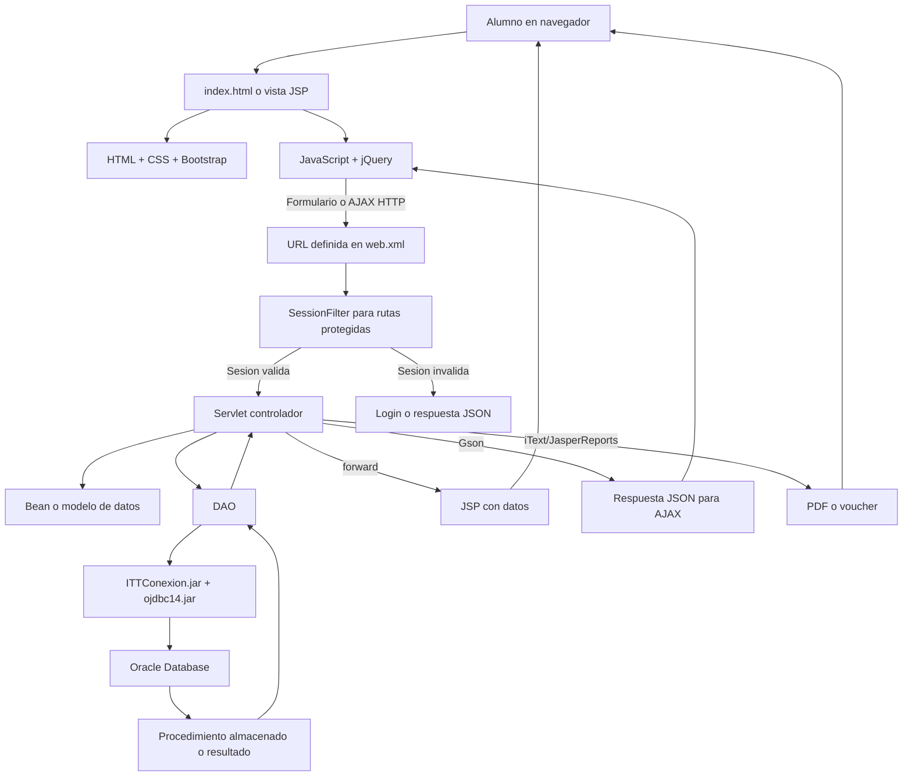

# Servicio Administrativo de Reducción del monto de inscripción

Aplicacion web del Instituto Tecnologico de Toluca para que los alumnos consulten informacion academica y realicen tramites escolares.

## 1. Resumen del proyecto

El proyecto esta construido con Java EE, JSP, Servlets, JavaScript y una base de datos Oracle. La aplicacion se compila con Apache Ant y se empaqueta como un archivo WAR para desplegarse en un servidor de aplicaciones compatible con Java EE, como Payara Server 5.

La aplicacion utiliza una arquitectura por capas:

```text
Presentacion -> Control -> Modelo de datos -> Acceso a datos -> Base de datos
```

## 2. Tecnologias del proyecto

| Orden | Tecnologia | Descripcion | Que hace | Para que se utiliza |
|---:|---|---|---|---|
| 1 | Java 8 | Lenguaje principal del proyecto. | Ejecuta la logica de negocio del lado del servidor. | Crear Servlets, DAO, beans, filtros y utilidades. |
| 2 | Java EE / Servlet API | Plataforma para desarrollar aplicaciones web Java. | Procesa peticiones HTTP y genera respuestas. | Implementar Servlets, sesiones, filtros y redirecciones. |
| 3 | JSP | Tecnologia para generar paginas HTML dinamicas. | Combina HTML con datos enviados por el servidor. | Mostrar login, portal, calificaciones, horarios, mensajes y formularios. |
| 4 | JSTL | Biblioteca de etiquetas para JSP. | Permite usar condiciones y decisiones dentro de las vistas. | Mostrar u ocultar contenido segun los datos recibidos. |
| 5 | HTML | Lenguaje de estructura de las paginas web. | Define formularios, botones, tablas y contenido. | Construir la interfaz que recibe el usuario en el navegador. |
| 6 | CSS | Lenguaje de estilos. | Controla colores, tamanos, posiciones y apariencia. | Dar formato a las vistas JSP y al portal. |
| 7 | JavaScript | Lenguaje que se ejecuta en el navegador. | Valida formularios y responde a eventos del usuario. | Actualizar la interfaz y realizar peticiones sin recargar toda la pagina. |
| 8 | jQuery y AJAX | Biblioteca JavaScript y mecanismo de comunicacion asincrona. | Envia y recibe datos mediante HTTP. | Validar CAPTCHA, iniciar sesion, cargar datos y actualizar modales o tablas. |
| 9 | JSON / Gson | Formato de intercambio y biblioteca de conversion. | Convierte objetos Java a JSON y JSON a objetos. | Comunicar respuestas entre Servlets y JavaScript. |
| 10 | JDBC para Oracle | API de Java para conectarse a bases de datos. | Abre conexiones y ejecuta consultas o procedimientos. | Permitir que los DAO consulten la base de datos institucional. |
| 11 | Oracle Database | Sistema gestor de base de datos. | Almacena y procesa la informacion academica. | Consultar alumnos, calificaciones, horarios, adeudos y tramites. |
| 12 | Procedimientos almacenados Oracle | Logica almacenada dentro de Oracle. | Recibe parametros y devuelve datos o resultados. | Centralizar operaciones de los diferentes modulos del portal. |
| 13 | JasperReports | Biblioteca de generacion de reportes. | Construye documentos a partir de plantillas JRXML. | Generar reportes, vouchers y documentos escolares. |
| 14 | iText | Biblioteca para crear y manipular archivos PDF. | Genera o procesa documentos PDF. | Entregar vouchers, constancias y otros documentos descargables. |
| 15 | Bootstrap | Biblioteca de estilos y componentes visuales. | Proporciona menus, formularios, modales y diseño responsivo. | Construir una interfaz adaptable a diferentes pantallas. |
| 16 | Font Awesome | Biblioteca de iconos. | Agrega iconos a botones y menus. | Representar mensajes, usuarios, alertas y acciones. |

> **Nota sobre Oracle 8:** el proyecto contiene el controlador `ojdbc14.jar`, pero los archivos del proyecto no permiten confirmar que el servidor de base de datos sea Oracle 8. Conviene registrar la version real de Oracle en la documentacion del ambiente de despliegue.

## 3. Herramientas de desarrollo y ejecucion

| Orden | Herramienta | Descripcion | Que hace | Para que se utiliza |
|---:|---|---|---|---|
| 1 | JDK 8u202 | Kit de desarrollo de Java version 8. | Compila y ejecuta el codigo Java. | Construir y ejecutar el proyecto con Java 8. |
| 2 | Java 1.8.0_202 | Version instalada del entorno Java. | Proporciona el compilador y la maquina virtual. | Mantener compatibilidad con el codigo y las bibliotecas existentes. |
| 3 | Apache Ant | Herramienta de automatizacion de compilacion. | Compila fuentes, copia recursos y genera el WAR. | Ejecutar tareas como `clean`, `compile`, `dist` y `deploy`. |
| 4 | NetBeans | IDE utilizado por la estructura del proyecto. | Edita codigo y administra proyectos Java web. | Abrir, compilar, depurar y desplegar la aplicacion. |
| 5 | Payara Server 5 | Servidor de aplicaciones Java EE. | Ejecuta Servlets, JSP y sesiones. | Desplegar y publicar el archivo WAR. |
| 6 | GlassFish / descriptores Java EE | Plataforma y configuracion compatible con el proyecto. | Define el contexto y el comportamiento web. | Configurar el despliegue mediante `glassfish-web.xml` y `web.xml`. |
| 7 | Navegador web | Cliente de la aplicacion. | Solicita paginas y recursos al servidor. | Usar el portal como alumno. |
| 8 | Oracle SQL Developer u otra herramienta Oracle | Herramienta externa de administracion de Oracle. | Permite revisar esquemas, tablas y procedimientos. | Administrar o verificar la base de datos, si el equipo la utiliza. |

> **Payara y GlassFish:** Payara es un servidor derivado de GlassFish. En este repositorio se observa el descriptor `glassfish-web.xml`; por eso la descripcion mas precisa es: **servidor Java EE compatible con GlassFish, utilizado en el ambiente como Payara Server 5**.

## 4. Archivos, bibliotecas y productos del proyecto

Estos elementos no son tecnologias independientes. Son archivos o componentes que permiten construir y ejecutar la aplicacion.

| Elemento | Tipo | Descripcion | Funcion |
|---|---|---|---|
| `ITTConexion.jar` | Biblioteca propia del ITT | Biblioteca institucional para administrar conexiones a la base de datos. | Crear conexiones Oracle y reportar errores de conexion. |
| `ITTUtilidades.jar` | Biblioteca propia del ITT | Utilidades compartidas por las aplicaciones institucionales. | Reutilizar funciones comunes, como registro de errores y apoyo al sistema. |
| `ojdbc14.jar` | Biblioteca de Oracle | Controlador JDBC de Oracle. | Permitir que Java se comunique con Oracle Database. |
| `gson-2.2.2.jar` | Biblioteca externa | Implementacion de Gson. | Convertir objetos Java a JSON y viceversa. |
| `jasperreports-6.5.1.jar` | Biblioteca externa | Motor de reportes. | Generar reportes desde plantillas JRXML. |
| `*.jrxml` | Plantilla de reporte | Archivos de diseno para JasperReports. | Definir la estructura visual de vouchers y reportes. |
| `web.xml` | Descriptor web | Configura Servlets, filtros y rutas URL. | Relacionar cada URL con su clase Java. |
| `glassfish-web.xml` | Descriptor del servidor | Define configuracion especifica del servidor. | Establecer el contexto `/ITTPortalAlumno`. |
| `build.xml` | Archivo de compilacion | Script principal de Apache Ant. | Invocar las tareas de compilacion y empaquetado. |
| `ITTPortalAlumno.war` | Paquete de despliegue | Archivo distribuible de una aplicacion web Java. | Instalar la aplicacion en Payara o GlassFish. |

### Componentes propios del codigo institucional

Ademas de las bibliotecas JAR, el proyecto contiene codigo organizado por responsabilidades:

| Carpeta | Nombre recomendado | Responsabilidad |
|---|---|---|
| `src/java/servlet` | Controladores web | Recibir peticiones y preparar respuestas. |
| `src/java/dao` | Objetos de acceso a datos | Consultar Oracle y ejecutar procedimientos almacenados. |
| `src/java/bean` | Modelos o beans de datos | Transportar informacion entre las capas. |
| `src/java/filters` | Filtros web | Validar sesiones y peticiones antes de llegar a un Servlet. |
| `src/java/utils` | Utilidades compartidas | Centralizar constantes, respuestas y funciones comunes. |
| `web/views` | Vistas JSP | Presentar la informacion al usuario. |
| `web/js` | Scripts del cliente | Validar formularios y realizar AJAX. |
| `web/css` | Hojas de estilo | Definir la apariencia del portal. |

> Si por “Archivo” te refieres a `Archivo_DAO.java`, su nombre correcto seria **DAO de gestion de archivos**. Es una clase del codigo institucional, no una tecnologia independiente. Si te refieres a un archivo general, conviene documentarlo por su nombre y extension concretos.

## 5. Flujo general de funcionamiento



## 6. Orden de uso de las partes

### En el navegador

```text
1. El alumno abre una pagina.
2. El servidor entrega HTML o JSP procesado.
3. El navegador carga CSS, JavaScript, imagenes y bibliotecas.
4. El usuario llena un formulario o selecciona una opcion.
5. JavaScript valida los datos y envia una peticion HTTP o AJAX.
```

### En el servidor

```text
6. web.xml identifica el Servlet correspondiente a la URL.
7. SessionFilter valida la sesion cuando la ruta esta protegida.
8. El Servlet recibe los parametros de la peticion.
9. El Servlet crea o utiliza un bean y llama al DAO.
10. El DAO solicita una conexion mediante ITTConexion.jar.
11. JDBC ejecuta una consulta o procedimiento almacenado en Oracle.
12. El DAO convierte el resultado en beans.
13. El Servlet envia la respuesta como JSP, JSON, texto, imagen o PDF.
14. El navegador muestra la respuesta al alumno.
```

## 7. Ejemplo: inicio de sesion

```text
login_view.jsp
    |
    v
loginVal.js
    |
    +--> validacaptcha.do
    |        |
    |        v
    |    ValCaptcha_Login_Srv
    |
    +--> login.do
             |
             v
       Login_Login_Srv
             |
             v
       User_Login_DAO
             |
             v
       ITTConexion.jar + ojdbc14.jar
             |
             v
       Oracle Database
             |
             v
       HttpSession con el usuario autenticado
             |
             v
       Portal_Portal_Srv
             |
             v
       Alumno_Portal_DAO
             |
             v
       portal_view.jsp
```

## 8. Resumen corto

```text
JDK 8 + Java
        |
        v
Apache Ant compila el proyecto
        |
        v
Se genera ITTPortalAlumno.war
        |
        v
Payara Server 5 ejecuta la aplicacion
        |
        v
JSP/HTML + CSS + JavaScript muestran la interfaz
        |
        v
Servlets procesan las peticiones
        |
        v
DAO + ITTConexion.jar acceden a Oracle
        |
        v
La respuesta vuelve como JSP, JSON o PDF
```
